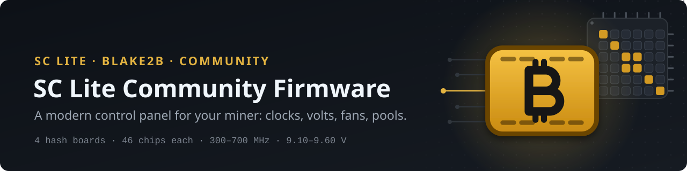
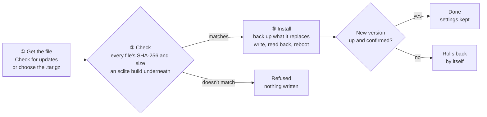
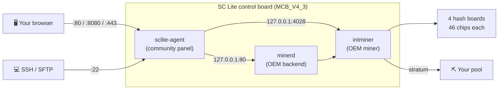

<p align="center">
  <picture>
    <source media="(prefers-color-scheme: dark)" srcset="assets/banner.svg">
    <source media="(prefers-color-scheme: light)" srcset="assets/banner-light.svg">
    
  </picture>
</p>

<p align="center">
  <a href="https://github.com/christhealien/sclite-community-firmware/releases/latest"></a>
  
  
  
  
</p>

<h3 align="center">A modern control panel for the SC Lite miner</h3>

<p align="center">
  An auto-tuner that measures · per-chip clock trims · fan curves and a thermal guard · a weekly schedule ·<br>
  cloud cut off, internal ports locked down · updates from the panel with automatic roll-back
</p>

<p align="center">
  <a href="#quick-start"><b>Quick start</b></a> ·
  <a href="#highlights">Highlights</a> ·
  <a href="#updating">Updating</a> ·
  <a href="#security--privacy">Security</a> ·
  <a href="#building-from-source">Build</a> ·
  <a href="#faq">FAQ</a> ·
  <a href="https://github.com/christhealien/sclite-community-firmware/releases">Releases</a>
</p>

<p align="center">
  
</p>

<p align="center"><sub>Screenshots come from a test setup with demo data (example pools, a demo wallet).</sub></p>

> [!WARNING]
> **Custom firmware can void your warranty** and, in the worst case, damage the miner. Nothing here is
> guaranteed safe for your hardware. Read [Safety](#safety) before you flash.

## Highlights

<table>
<tr>
<td width="50%" valign="top">

#### ⚙️ Control
- **Clock** in 12.5 MHz steps and **board voltage (PV) 9100–9600**, the range the supply really delivers
- **Auto-tuner** maps every clock at the lowest voltage that runs clean and builds tested presets
- **Per-chip trims** (−100 to +50 MHz), **auto-trim** and **Find strong chips**
- **Presets** with their own fan curves, plus built-in *Stock* and *Idle*

</td>
<td width="50%" valign="top">

#### 📊 Monitoring
- **Live dashboard** and a 24-hour hashrate chart with restarts, changes and rejected shares marked
- **All 184 chips** on one map, weak chips flagged; a card per board
- **Power estimate** in W and J/TH, calibrated with your own wall meter
- **Notifications** to Telegram, Discord, ntfy, Gotify or a webhook; a live, colour-coded miner log

</td>
</tr>
<tr>
<td width="50%" valign="top">

#### 🌡️ Fans and heat
- **Auto fan** with curves down to 10 % that you drag into shape, and a fan pair offset
- **Thermal guard:** fans to 100 %, then Idle with a timed cool-down
- **The OEM's fan check** kept, stricter about a dead fan, and fitted to your own fans
- **Weekly schedule:** paint presets onto the week in half-hour blocks, plus scheduled restarts

</td>
<td width="50%" valign="top">

#### 🔐 Private by design
- **No cloud.** The OEM's cloud and miner finder are cut off
- **Internal ports closed:** the stock backend and miner API answer the miner itself only
- **Mines only where you say:** no pool redirects, and a pool guard
- **One password** for panel and SSH, stored as PBKDF2-HMAC-BLAKE2b-512

</td>
</tr>
</table>

<table>
<tr><td width="70%"></td>
<td width="30%"></td></tr>
<tr><td>Presets built and tested by the tuner, each with its own fan curve</td><td>Works on a phone, light or dark</td></tr>
</table>

## Quick start

1. Download `sclite-firmware-v1.5.28-SCLITE_MCB_V4_3.img.xz` and `SHA256SUMS` from the
   [latest release](https://github.com/christhealien/sclite-community-firmware/releases/latest) and check it:
   `sha256sum -c SHA256SUMS --ignore-missing` must say `OK` (macOS: `shasum -a 256 <file>`, Windows:
   `certutil -hashfile <file> SHA256`, and compare with its line in `SHA256SUMS`).
2. Write the `.img.xz` to a microSD card (4 GB or larger) with **balenaEtcher**. Other tools need it unpacked
   first with `xz -dk` or 7-Zip; renaming `.img.xz` to `.img` doesn't unpack it.
3. Power the miner **off**, put the card in the SD slot next to the indicator lights, power **on**. Red and green
   blink while it writes (about 2 minutes). When **only green blinks**, pull the card; the miner reboots by itself.
4. Open `http://<miner-ip>/` (the address is in your router's device list). Sign in with `admin` / `admin`,
   choose your own password and read the risk notice. The same login works for SSH: `ssh <username>@<miner-ip>`.
5. Add your pool in the **Pools** tab. On a fresh setup the miner starts mining once a pool exists, usually
   within a minute.

Already running this firmware (v1.4.8 or later)? Skip the SD card and [update from the panel](#updating).

> [!IMPORTANT]
> **Flashing may reset the miner's settings.** Keep your pool address and worker name handy.

## What's new in v1.5.28

No change to mining, clocks, voltages or fans.

- **Vendor-neutral wording everywhere.** The panel, its messages, notifications and activity log, the tuner
  log, the files the firmware writes (`/etc/sclite-release`), the build kit and this README now call the
  miner's manufacturer "the OEM".
- **Log export:** the stock programs' logs in the export zip are now named `oem-watchdog-xminerd.txt`,
  `oem-fans-fanctrl.txt` and `oem-backend-minerd.txt`.
- **New README and logo:** the same layout as the SC Box II firmware's, with the panel's gold ₿ block as the
  project mark.

Recently: an **update progress bar** that follows the install across the restart (v1.5.27); the SD image no
longer ships the factory random seed that was the same on every unit (v1.5.27); a firmware-specific
**serial-console recovery login** in place of the OEM's public factory password (v1.5.26).
Every release has its own notes on the [releases page](https://github.com/christhealien/sclite-community-firmware/releases).

## Updating

From v1.4.8 on, a new release installs from the panel: **Settings → Firmware update**.



- **Check for updates** gets the latest release from GitHub and compares it with the release's `SHA256SUMS`.
  **Check file** works without internet: choose `sclite-update-v1.5.28.tar.gz` (not the `.img.xz`), and paste
  the release's `SHA256SUMS` to confirm it's the published file.
- **Install** shows each stage with a progress bar, also on the Dashboard while the miner restarts, and says
  how it went once the miner answers again.
- **Settings, pools, presets and schedule stay.** The new version confirms after it has run for 90 seconds;
  if it isn't up within 5 minutes, the miner restores the previous version and reboots by itself.
  **Roll back** in the panel does the same by hand.
- Packages are checked, not signed: anyone can build and install their own.

> [!NOTE]
> **Jumping several versions at once?**
> - **From v1.5.11 or earlier:** the miner may get a new IP address once (it now identifies to your router by
>   its MAC address). Look in your router's device list; a DHCP reservation by MAC keeps it fixed.
> - **From v1.5.5 or earlier:** tuning starts fresh, once. Presets made by those versions were judged with a
>   lagging hashrate and voltage settings the supply ignores, so they are moved aside (Settings → Firmware
>   update can put them back), the miner returns to stock and a schedule that used them is switched off.
>   Then run the Tuner. Nothing is cleared coming from v1.5.6 or later.
> - **From v1.4.4 or earlier:** flash the SD image once; after that, updates come from the panel.
> - **Passwords from v1.5.22 on** move to PBKDF2-HMAC-BLAKE2b-512 at your first sign-in. Rolling back, or
>   installing an older update package, asks for your password once and saves it the old way. An older
>   release flashed from an SD card starts over at `admin` / `admin`.
> - **v1.4.5 and v1.4.6 were withdrawn** (their panel didn't start). If you flashed one, flash the latest
>   release from an SD card.

| Release file | What it is for |
|---|---|
| `sclite-update-v1.5.28.tar.gz` | Update from the panel, over v1.4.8 or later (not for the SD card) |
| `sclite-firmware-v1.5.28-SCLITE_MCB_V4_3.img.xz` | First install, or recovery, from a microSD card |
| `sclite-firmware-v1.5.28-source.tar.gz` | The source: the control panel (Go) and the build kit |
| `SHA256SUMS` | SHA-256 of the files above |

## How it works

The new panel replaces the OEM's web interface. The OEM's mining programs keep running the hash boards, and a
small library loaded into them turns their listening sockets into loopback ones, so nothing on your network can
reach them directly. (The kernel has no netfilter, so there is no firewall to use.)



| | |
|---|---|
| **Miner** | SC Lite (Blake2b / Siacoin): 4 hash boards, 46 chips each (184 in all) |
| **Control board** | MCB_V4_3, InfoTM, Ethernet only (no Wi-Fi chip) |
| **Panel** | port **8080** (http and https; can be moved), also 80 on the LAN address and https on 443; SSH/SFTP on 22 |
| **Voltage** | PV 9100–9600: the supply follows PV to within about 10 mV between about 9.1 V and 9.6 V |
| **Based on** | the OEM's stock SC Lite SD image 2.2.0 (not included here) |

### The control panel

| Tab | What it does |
|---|---|
| **Dashboard** | live hashrate (the boards' own figures, no lag after a restart), power and J/TH, temperatures, fans and shares; 24-hour hashrate chart; per-chip map of all 184 chips; per-board cards; best-share record |
| **Controls & fan** | clock and board voltage; auto fan with built-in, your own and tuner-made curves; fan pair offset; the OEM's fan check fitted to your fans; thermal guard; chip trims (by hand, auto-trim, Find strong chips, ⤓ Save report) |
| **Presets** | saved clock, voltage and fan settings, applied in one click; built-in Stock and Idle |
| **Schedule** | paint presets onto a week in half-hour blocks; scheduled restarts (each one reboots the miner) |
| **Pools** | add, edit, reorder and remove pools; the pool guard keeps the miner on these only |
| **Tuner** | maps clock against board voltage, confirms the best setting, can trim weak chips, builds tested presets |
| **Log** | live miner log, colour-coded; optional verbose mode with every share and the pool's answer; save the logs, or a copy with private details taken out |
| **Settings** | firmware update and roll back, username and password, SSH, network and MAC address, power calibration, time zone and time servers, notifications, restart and reboot, an automatic restart when a board stops hashing |

<p align="center">
  
</p>

<table>
<tr><td width="50%"></td>
<td width="50%"></td></tr>
<tr><td>Clock and PV, locked while a preset or the schedule is in charge</td><td>Drag a curve into shape; the thermal guard sits on top</td></tr>
<tr><td width="50%"></td>
<td width="50%"></td></tr>
<tr><td>A week painted with presets and restarts</td><td>The tuner: map, confirm, or rebuild presets</td></tr>
<tr><td width="50%"></td>
<td width="50%"></td></tr>
<tr><td>Notifications, each event on or off</td><td>The live miner log</td></tr>
</table>

### The tuner

1. **Baseline:** a run at stock settings learns every chip's normal error rate.
2. **Map:** each clock (12.5 MHz steps) starts at the lowest board voltage and steps up until it runs clean for
   the whole test. A chip that throws errors far beyond its own baseline fails the test, not the board's average.
3. **Trims (optional):** when one chip fails, the tuner can slow just that chip instead of raising the voltage
   for all 46.
4. **Confirm:** the best settings run again for longer; the winner is the one that holds.
5. **Presets:** High, Middle, Low and Lowest power are built from the map and tested, each with its own fan curve.

Stop puts everything back as it was, including any trims the run made; a watchdog ends a run that stops moving.

### Chip trims

Normally every chip runs at its board's clock, so the whole board ends up set for its weakest chip. A chip trim
runs one chip **slower (−12.5 to −100 MHz)** or **faster (+12.5 to +50 MHz, never above the clock ceiling)**
than the rest of its board (**Controls & fan → Chip trims**, off by default).

The OEM's mining program already has a per-chip clock function but always sets every chip to the board clock.
The firmware adds a 34-byte hook, placed in the program's never-called per-chip tuning code, which calls a small
library after each clock change; the library sets the trimmed chips with the program's own function. The same
copy carries two guards (a board that answers with 0 chips, and bad input from a pool, no longer stop all four
boards). If it fails to start three times in a row, the firmware runs the OEM's unmodified program by itself.

<p align="center">
  
</p>

**Chip pairs.** The board voltage runs through **23 power stages in series**, two chips in each (about 0.41 V per
stage). Self-tests on christhealien's own miner (built in from v1.4.2 to v1.5.20) showed the pairs are
**1–2, 3–4, 5–6 …** (blue boxes): a − trim gives a chip's partner a small boost, a + trim takes a little from it,
and trimming both chips of a pair costs the rest of the board clearly more than one per pair. So **auto-trim**,
the **tuner** and **Find strong chips** all trim at most one chip per pair. **⤓ Save report** saves the trims,
every chip's counters, 48 hours of history and the library's log as one file: send it in for a look.

<details>
<summary><b>Measured data: one miner mapped by the tuner, board voltage, chip-trim self-tests</b></summary>

<p align="center"></p>

A 13-hour tuner run on one SC Lite (all four boards, 70–73 °C), each clock at the lowest board voltage it ran clean
at for 25 minutes:

| Clock (MHz) | Lowest clean PV (mV) | Hashrate (TH/s) | Fans |
|---:|---:|---:|---:|
| 525 | 9100 | 3.86 | 28 % |
| 550 | 9100 | 4.01 | 31 % |
| 575 | 9100 | 4.23 | 33 % |
| 600 | 9100 | 4.41 | 34 % |
| 625 | 9150 | 4.57 | 36 % |
| 650 | 9300 | 4.73 | 40 % |
| 675 | 9350 | 4.95 | 44 % |
| 700 | 9450 | 5.14 | 49 % |

Up to 600 MHz this miner ran clean at the supply's lowest voltage. Above that, one board set the voltage for all
four, and 575–700 MHz used a few chip trims on that board. Your miner will differ: that's what the tuner is for.

**Board voltage**, measured with a multimeter on the supply rail: only the PV setting moves the supply. It follows
PV to within about 10 mV between a floor of about **9.1 V** and a ceiling of **9.6 V**; lower or higher settings
are ignored. The run-voltage setting (mV) is applied briefly at start and then replaced by PV. The miner's own
voltage reading sits about 50–80 mV below the rail.

**Chip trims**, real hardware: in two self-test runs at −50 MHz the trimmed chips slowed by **5.2 % ± 3.0** and
the chips beside them didn't change. The miner's per-chip error list and the hook number the chips the same way,
and the per-chip nonce counts match chip for chip. Chip pairs, christhealien's SC Lite (625 MHz, PV 9100):

| Test | Result |
|---|---|
| Trim reaches its chip (c2, c6 … at −50 MHz) | passed; the chip *before* each kept its rate (+0.3 %) while the rest of the board dipped 11 % |
| Check the chip pairs (c1, c5 …) | confirmed; the chip *after* each kept its rate (−0.4 %) while the rest dipped 10 % (4.5 standard errors) |
| Pair layout across the board (12 h) | blue-box partners +9.4 % against the rest (11.8 standard errors); one chip off +2.6 %; across the halves −0.7 % |
| Check the chip pairs, again (v1.5.20) | confirmed; the chip *after* each +1.7 % while the rest dipped 6.5 % |
| Both chips of a pair (c1+c2, c9+c10 …) | the rest of the board dipped **16.4 %**, against 6.5 % with the same 12 chips spread one per pair |

One trim per pair where you can, and on a miner near its voltage floor raise PV a step instead of adding trims.
</details>

### Compared with stock

| | Stock 2.2.0 | This firmware |
|---|---|---|
| Web panel | the OEM's UI on port 80 | new panel on 80, 8080 and https 443 |
| OEM backend and miner API (4028) | open to the network | reachable only from inside the miner |
| OEM cloud | on (MQTT hub and miner finder) | cut off |
| Login | shared default password | `admin` / `admin`, then you must choose a new one |
| Internet check | every 3 s: your pool's host, then two public websites | asks the panel on the miner (127.0.0.2); the pools only if that fails; no outside hosts |
| Pool redirects | a pool can move the miner to another server | refused; the pool guard removes any pool that isn't in your Pools tab |
| Wi-Fi, mDNS, test programs | installed | removed (the board has no Wi-Fi chip) |
| SSH | none | built in on port 22 with the panel's login (shell, `sftp`, and `scp` from OpenSSH 9 or later) |
| Time sync | servers in China, time zone fixed to China | your own time server and your router's (DHCP); pool.ntp.org only when neither gives a time (can be switched off); time zone from your browser |
| MAC address | random at every boot on some units | kept the same by default; or random each boot, or one you choose |
| Tuning | fixed power plans | auto-tuner, presets, schedule, per-chip trims |
| Fans | fixed modes | curves down to 10 %, fan pair offset, thermal guard with a cool-down |
| Updates | SD card | from the panel, with automatic roll-back |

## Security & privacy

| Port | What | Default |
|---|---|---|
| 8080 | Panel, http and https | on; can be moved (1024–65535) |
| 80 | Panel, on each LAN address (the OEM backend keeps 127.0.0.1:80) | on |
| 443 | Panel, https only | on |
| 22 | SSH and SFTP, with the panel account | on; on/off and port in Settings |

- **No phone-home.** The OEM's cloud hub and miner finder resolve to 127.0.0.1. The internet check asks the miner
  itself instead of outside hosts. Wi-Fi and mDNS are removed.
- **By default the miner contacts only** your router (DHCP), time servers (yours and the router's, then
  `pool.ntp.org` as a last resort, which can be switched off) and DNS for their names. Pools, notifications and
  GitHub only when you set them up or ask for an update.
- **Works on a LAN without internet**, with a pool on your network.
- **One password** for panel and SSH, stored as PBKDF2-HMAC-BLAKE2b-512; changing the username or password needs
  the current one. Five wrong passwords block that address for 10 minutes.
- **Made per unit:** the SSH host key and the panel's https certificate (self-signed, so a browser warns once).
  The host keys and the random seed that were the same on every stock unit are not in the image.
- **Locked down:** the `default` account and the OEM-named login are locked; the serial-console root password is
  a firmware-specific recovery password instead of the OEM's published one; SD and USB drives mount without
  setuid or device files.
- **Log exports for sharing** take out pool addresses and accounts, wallet, worker and miner names, IP and MAC
  addresses and secrets.
- **Not changed:** the kernel (Linux 3.10), uClibc 0.9.33.2, OpenSSL 1.0.1e, curl 7.33 and BusyBox 1.21 are the
  stock versions, because the OEM's closed-source programs are built against them and there is no vendor kernel
  source. With the cloud cut off and only the new panel listening on the network, none of them faces it.

## Safety

- **Warranty:** custom firmware may void your warranty. You use it at your own risk.
- **Board voltage never goes above PV 9600**, the supply's own ceiling.
- **Thermal guard:** at the safety temperature (88 °C by default, two readings in a row) the fans go to 100 %;
  if a board is still that hot 90 seconds later, or 5 °C past it, the miner goes to Idle to cool down and tells
  you why.
- **The OEM's fan check stays**, stricter about a fan that has already died, and mining locks on Idle after a
  fan failure. Fitting it to your own fans changes only the fan figures: the OEM's over-temperature cut-off is
  never raised, and the miner checks that at every start.
- **Clocks stay in a safe window** unless you unlock the limit on purpose; changes apply live, no reboot.
- **Back to stock is one SD flash away** (see the FAQ). A serial-console login (`root` / `sclite-recover`, on the
  UART pins inside the miner, not over the network) is a physical way back in.

## Building from source

The build kit takes **your own copy** of the OEM's stock SD image 2.2.0 (`burn-…-SCLITE_MCB_V4_3-2_2_0.img`,
SHA-256 `27051af0…df0bfe`) and changes only the system filesystem inside it. This repository contains no stock
firmware. You need **Go 1.24.7 exactly** (another version builds a different panel binary; with Go 1.21 or newer,
`GOTOOLCHAIN=go1.24.7` gets it), Python 3 and e2fsprogs. The panel's libraries are in `agent/vendor/`, so the
build needs no downloads.

```sh
tar xzf sclite-firmware-v1.5.28-source.tar.gz && cd sclite-firmware
# 1. the panel
cd agent && CGO_ENABLED=0 GOOS=linux GOARCH=arm GOARM=7 go build -trimpath -buildvcs=false -ldflags="-s -w" -o ../sclite-agent-arm . && cd ..
# 2. the image and the update package
python3 firmware-kit/build.py --stock burn-…-SCLITE_MCB_V4_3-2_2_0.img \
        --agent sclite-agent-arm --out sclite-firmware.img --version 1.5.28 --xz \
        --update-out sclite-update-v1.5.28.tar.gz
```

The build only accepts the known stock image and checks every edit. It reads every written file back and starts
the panel from the finished image 5 times under emulation (needs root and a static qemu-arm, e.g.
`qemu-user-static`; `--skip-startup-check` skips it, not for releases), and refuses to write an image if anything
doesn't match. It is **reproducible**: the same stock image and source give the same image, byte for byte.

## FAQ

<details>
<summary><b>Where do I get the stock firmware?</b></summary>

From the **[stock-2.2.0 release](https://github.com/booozytheclown/goldshell-sclite-firmware/releases/tag/stock-2.2.0)**
in a third-party archive: `burn-…-SCLITE_MCB_V4_3-2.2.0.tgz`, SHA-256
`1c84eebc9ca1b75e69cb729f64f6fb7dbc59a30bd8ee42049e6186de145eb433`. Unpack it; the `.img` inside is what you flash
to go back to stock, and what the build takes.
</details>

<details>
<summary><b>Can I go back to the stock firmware?</b></summary>

Yes. Flash the stock image from a microSD card, the same way you installed this one.
</details>

<details>
<summary><b>Why PV and not the voltage in mV?</b></summary>

Measured with a multimeter on the supply rail, only PV moves the supply; the run voltage (mV) is replaced by PV a
few seconds after it's set. The supply follows PV between about 9.1 V and 9.6 V, so that's the range the panel
offers. To use less power below 9.1 V, lower the clock.
</details>

<details>
<summary><b>Where do the watts come from?</b></summary>

The miner has no power sensor. Watts and J/TH are estimates from typical SC Lite figures until you calibrate with a
plug-in wall meter in **Settings → Power & calibration**.
</details>

<details>
<summary><b>Does it need the internet?</b></summary>

No. With a pool on your LAN and a time server on your network (or your router's), it runs without internet. The
internet is only used for what you set up (an internet pool, notifications), public time servers as a last resort
(can be switched off in **Settings → Time**), and when you check for an update. For the first minute after boot the
clock reads 1970 until time sync finishes; the panel holds charts, records and the schedule until it's right.
</details>

<details>
<summary><b>The browser or SSH warns about the miner's certificate or key.</b></summary>

The https certificate is self-signed and unique to your miner: accept it once, or use plain `http://`. SSH asks you to
confirm the key the first time (its fingerprint is in **Settings → Network & SSH**). After a reflash the miner may make
a new key; remove the old one with `ssh-keygen -R <miner-ip>`.
</details>

<details>
<summary><b>Does it work over Wi-Fi?</b></summary>

No. The SC Lite control board has no Wi-Fi chip. Use Ethernet.
</details>

<details>
<summary><b>Does it work on other miners?</b></summary>

No. This firmware is for the SC Lite (control board MCB_V4_3) only. The SC Box II has its own
[community firmware](https://github.com/christhealien/scbox2-community-firmware) by the same author.
</details>

## Repository layout

| Path | Contents |
|---|---|
| `README.md` | This page |
| `assets/` | Banner and logo |
| `docs/screenshots/` | The screenshots on this page |
| [Releases](https://github.com/christhealien/sclite-community-firmware/releases) | The SD image, the update package, `SHA256SUMS`, release notes, and the source (`agent/`: the panel's Go source; `firmware-kit/`: the build kit) |

Contributions are welcome: open an Issue for findings or a Pull Request for documentation and tools. Chip reports
from **Controls & fan → Chip trims → ⤓ Save report** are especially welcome. Please don't publish passwords, private
keys, device credentials or personal information.

## Credits and disclaimer

Built by **christhealien**. The [SC Box II community firmware](https://github.com/christhealien/scbox2-community-firmware)
by the same author is built on this one.

This is an independent community project. It is not affiliated with, endorsed by or supported by the miner's
manufacturer, and it uses none of their logos or designs. The model name is used only to identify the hardware this
firmware runs on. The OEM's firmware and documentation remain subject to their respective intellectual property
rights; no stock firmware is included in this repository. The SD image contains the OEM's proprietary programs as
shipped in the stock image, and open-source components under their own licenses (GPL, LGPL and others).

Modifying and flashing firmware carries risks, including hardware damage and device failure. This firmware is
provided as is, without warranty of any kind.

<!-- OWNER TODO: license not decided yet. Replace the next line and add a LICENSE file once chosen. -->
**License: TBD.**
