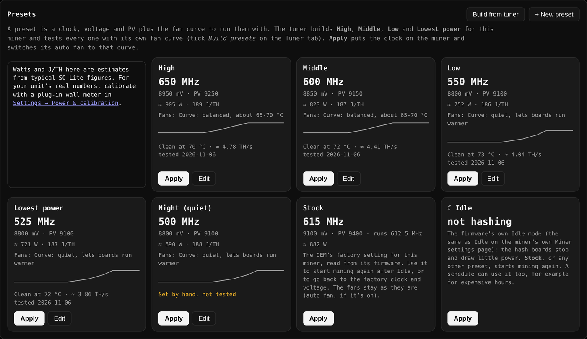
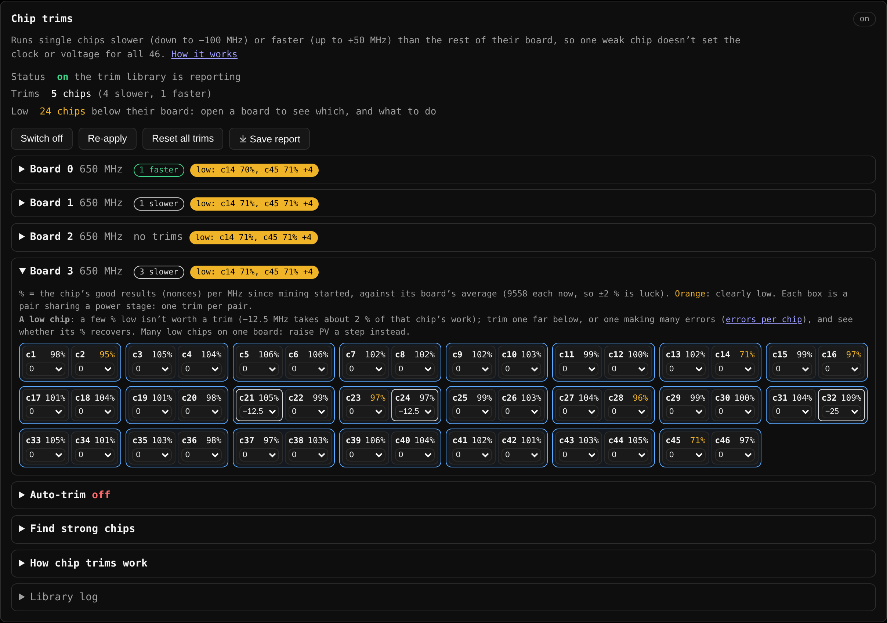

# SC Lite Community Firmware

Community firmware for the **SC Lite** ASIC miner made by Goldshell (Blake2b / Siacoin, control board
**MCB_V4_3**): a new control panel, a hardware-aware auto-tuner, per-chip clock trims, smarter fan and
thermal control, the Goldshell cloud removed and the miner's internal ports locked down.

> Independent project: not affiliated with, endorsed by or supported by Goldshell.

**[⬇ Download the latest release](../../releases/latest)** · [What's new](../../releases/latest) ·
[Install](#install) · [Upgrade without an SD card](#upgrading-no-sd-card) · [Measured data](#measured-data)

Screenshots in this README come from a test setup with demo data (example pools, a demo wallet).

---

## Highlights

- **A new control panel** for desktop and phone: dashboard, clock and voltage, fan curves, presets, a weekly
  schedule, pools, an auto-tuner, live logs and notifications. Light and dark themes.
- **An auto-tuner that measures, not guesses.** It maps every clock at the lowest board voltage that runs
  clean, judges each chip by its own error rate, confirms the winner over a longer test, and builds tested
  presets with their own fan curves.
- **Per-chip clock trims:** run single weak chips slower (down to −100 MHz) or strong chips faster (up to
  +50 MHz) than the rest of their board. Built on per-chip clock code already in the miner that Goldshell
  never switched on. Self-tests on real miners proved that each trim reaches the chip it names and how the
  chips share power (they were built in from v1.4.2 to v1.5.20).
- **Safety first:** board voltage never goes above PV 9600; a thermal guard steps up fans, throttles the
  clock and finally puts the miner on Idle with a timed cool-down; Goldshell's fan check is kept and can be
  fitted to your own fans; mining locks on Idle after a fan failure.
- **Mines only where you say:** a pool guard stops the miner if it ever runs a pool that isn't in your Pools tab.
- **Private by default:** the Goldshell cloud is cut off, the miner's internal API is no longer on the network,
  and log exports for sharing take out pool accounts, wallet, addresses and secrets.
- **Updates without an SD card**, with automatic roll-back if the new version doesn't start properly.

<table>
<tr><td width="70%"></td>
<td width="30%"></td></tr>
<tr><td>Presets built and tested by the tuner, each with its own fan curve</td><td>Works on a phone, light or dark</td></tr>
</table>

---

## The control panel

Open `http://<miner-ip>/` in any browser (also on port 8080, and https on 443).

| Tab | What it does |
|---|---|
| **Dashboard** | live hashrate (the boards' own figures, no lag after a restart), power and J/TH, temperatures, fans and shares; 24-hour hashrate chart with restarts, setting changes and rejected shares marked; per-chip map of all 184 chips; per-board cards; best-share record |
| **Controls & fan** | clock and board voltage (PV 9100–9600, the range the supply really delivers); auto fan with curves down to 10 % (built-in, your own and tuner-made, all editable); fan pair offset for quieter fans; Goldshell's fan check fitted to your own fans; thermal guard; chip trims (by hand, auto-trim, find strong chips, ⤓ Save report) |
| **Presets** | saved clock, voltage and fan settings, applied in one click; built-in Stock and Idle |
| **Schedule** | paint presets onto a week in half-hour blocks (cheap and expensive hours, quiet nights); scheduled restarts |
| **Pools** | add, edit, reorder and remove pools; the pool guard watches that the miner only mines to these |
| **Tuner** | maps clock against board voltage, confirms the best setting, can trim weak chips, builds tested presets; a live run plan shows every step |
| **Log** | live miner log, colour-coded; optional verbose mode with every share and the pool's answer; save the logs, or a copy with private details taken out |
| **Settings** | firmware update, password, SSH, network and MAC address, power calibration with a wall meter, time zone, notifications, restart and reboot |

### Dashboard

Every chip of every board, shaded by its hardware errors; weak chips stand out and each one shows its own
numbers on hover. The board cards give each board's hashrate, clock, voltage, temperatures and chips found.

<table>
<tr><td width="50%"></td>
<td width="50%"></td></tr>
</table>

### Controls & fan

Clock in 12.5 MHz steps and board voltage (PV) in the range the supply really follows, with an estimate
of the watts at every setting. While a preset or the schedule is in charge, the controls are locked so
nothing fights over the miner.

Drag points to shape a curve, test it with the temperature slider, and keep your own curves next to the
built-in ones. The **thermal guard** sits on top of every curve: at the safety temperature (88 °C by default,
two readings in a row) the fans go to 100 %; if a board is still that hot 90 seconds later, or 5 °C past it,
the miner goes to Idle to cool down and tells you why.

### Schedule

Paint presets onto the week: full power at night, a lower-power preset during expensive hours, a quiet one
at weekends. Restarts can be scheduled too.

### Tuner

The tuner tests real settings on your miner, one after another, and keeps what passes:

1. **Baseline:** a run at stock settings learns every chip's normal error rate.
2. **Map:** each clock (in 12.5 MHz steps) starts at the lowest board voltage and steps up until it runs
   clean for the whole test. Each next clock starts where the one before passed, so nothing is tested twice.
   A chip that throws errors far beyond its own baseline fails the test, not the board's average.
3. **Trims (optional):** when one chip fails a test, the tuner can slow just that chip and try again instead
   of raising the voltage for all 46.
4. **Confirm:** the best settings run again for longer; the winner is the one that holds.
5. **Presets:** High, Middle, Low and Lowest power are built from the map and tested, each with its own fan curve.

Stop puts everything back as it was, including any trims the run made. A watchdog ends a run that stops
moving and restores the miner.

### Notifications

Telegram, Discord, ntfy, Gotify or a webhook: a miner stops answering, a board stops hashing, a fan fails,
it got too hot, the thermal guard stepped in, a chip turned weak, a tuning run finished, a firmware update was
installed or rolled back, a new best share, and more. Each event can be switched on or off.

### Log and updates

<table>
<tr><td width="50%"></td>
<td width="50%"></td></tr>
</table>

---

## Chip trims

Each SC Lite hash board has 46 chips. Normally every chip runs at its board's clock, so the whole board ends
up set for its weakest chip. A **chip trim** runs one chip at a different clock from the rest of its board
(Controls & fan → Chip trims):

- **slower (−12.5 to −100 MHz)** for a chip that makes more errors than the others, so the rest of the board
  can run faster or at a lower voltage;
- **faster (+12.5 to +50 MHz)** for a strong chip with headroom, never above the clock ceiling.

**How it works.** Goldshell's mining program already has a per-chip clock function and keeps a clock for every
chip, but always sets them all to the board clock; its own per-chip tuning code is never called. The firmware
adds a 34-byte hook, placed in that unused code, which calls a small library right after each clock change.
The library sets the trimmed chips using the program's own per-chip function, ramping them in small steps.
With trims switched off, Goldshell's unmodified program runs. If the trimmed copy fails to start, the
firmware falls back to stock by itself.

**Chip pairs.** The board voltage (PV, about 9.4 V) runs through **23 power stages in series**, two chips side
by side in each (about 0.41 V per stage). A test by christhealien on his own miner showed which two share a
stage: with chips 2, 6, 10 … slowed, the whole board made slightly less good work, except the chip just before
each slowed one, which kept its rate because it got the voltage its partner gave up. That points to pairs
**1–2, 3–4, 5–6 …**, shown as blue boxes, and three self-tests on his miner later confirmed it (see
[Measured data](#chip-trims-1)). A − trim gives a chip's partner a small boost; a + trim takes a little from it.

**Helpers:**

- **Auto-trim** watches each chip's errors and slows a board's worst chips one step at a time, undoing any
  step that doesn't help. It trims **at most one chip per pair**, and stops adding trims to a board whose
  untrimmed chips start erroring more (then raising PV a step is the better fix).
- **The tuner** can trim the chip that fails a test instead of raising the board voltage, also one per pair.
- **Find strong chips** raises up to 10 of a board's cleanest chips +12.5 MHz at a time, up to +50, never
  both chips of one pair, and keeps what passes.

**The self-tests** (v1.4.2 to v1.5.20) switched test trims on and off every 15 minutes for hours and compared
each chip with itself, trims on against trims off. They settled that a trim reaches the chip it names and that
chips 1–2, 3–4 … share a power stage (results under [Measured data](#chip-trims-1)), so they were removed in
v1.5.21. Updating during a test puts your own trims back.

**⤓ Save report** on the Chip trims card saves one file with the trims, every chip's clock, nonce counts and
errors, 48 hours of history, the library's log, auto-trim and Find strong chips: send it in for a look.

---

## Measured data

### One miner, mapped by the tuner

A 13-hour tuner run on one SC Lite (all four boards, 70–73 °C). Each clock is shown at the lowest board
voltage it ran clean at for 25 minutes:

| Clock (MHz) | Lowest clean PV (mV) | Hashrate (TH/s) | Fans |
|---:|---:|---:|---:|
| 525 | 9100 | 3.86 | 28 % |
| 550 | 9100 | 4.01 | 31 % |
| 575 | 9100 | 4.23 | 33 % |
| 600 | 9100 | 4.41 | 34 % |
| 625 | 9150 | 4.57 | 36 % |
| 650 | 9300 | 4.73 | 40 % |
| 675 | 9350 | 4.95 | 44 % |
| 700 | 9450 | 5.14 | 49 % |

Up to 600 MHz this miner ran clean at the supply's lowest voltage. Above that, one board (board 3) set the
voltage for all four, and 575–700 MHz used a few chip trims on that board. Your miner will differ: that's what
the tuner is for.

### Board voltage

Measured with a multimeter on the supply rail:

- Only the board voltage setting (**PV**) moves the supply. It follows PV to within about 10 mV between a floor
  of about **9.1 V** and a ceiling of **9.6 V**; lower or higher settings are ignored.
- The run-voltage setting (mV) is applied briefly at start and then replaced by PV.
- The miner's own voltage reading sits about 50–80 mV below the rail.

### Chip trims

- Real hardware, two self-test runs at −50 MHz: the trimmed chips slowed by **5.2 % ± 3.0**, and the chips
  beside them didn't change (the clock change predicts 8 %, a difference that isn't statistically significant).
- On a real SC Lite, the miner's per-chip error list and the hook number the chips the same way, and the
  per-chip nonce counts match chip for chip.
- **Chip pairs, christhealien's SC Lite (625 MHz, PV 9100):** three self-tests agree on pairs 1–2, 3–4 …

  | Test | Result |
  |---|---|
  | Trim reaches its chip (c2, c6 … at −50 MHz) | passed; the chip *before* each kept its rate (+0.3 %) while the rest of the board dipped 11 % |
  | Check the chip pairs (c1, c5 …) | confirmed; the chip *after* each kept its rate (−0.4 %) while the rest dipped 10 % (4.5 standard errors) |
  | Pair layout across the board (12 h) | blue-box partners +9.4 % against the rest (11.8 standard errors); one chip off +2.6 %; across the halves −0.7 % |
  | Check the chip pairs, again (v1.5.20) | confirmed; the chip *after* each +1.7 % while the rest dipped 6.5 % |
  | Both chips of a pair (c1+c2, c9+c10 …) | the rest of the board dipped **16.4 %**, against 6.5 % with the same 12 chips spread one per pair |

  Slowing chips takes good work from every other chip, and **trimming both chips of a pair costs the rest of
  the board clearly more** than spreading the same trims one per pair (16.4 % against 6.5 %, 6 standard
  errors). So: one trim per pair where you can, and on a miner near its voltage floor raise PV a step instead of
  adding trims.

---

## Compared with stock

| | Stock 2.2.0 | sclite firmware |
|---|---|---|
| Web panel | Goldshell UI on port 80 | new panel on 80, 8080 and https 443 |
| Goldshell backend and miner API (4028) | open to the network | reachable only from inside the miner |
| Goldshell cloud | on (hub.goldshell.com) | cut off |
| Login | shared default password | `admin` / `admin`, then you must choose a new one |
| Wi-Fi, mDNS, test programs | installed | removed (the board has no Wi-Fi chip) |
| SSH | none | built in on port 22, using the panel's username and password (shell, `scp`, `sftp`) |
| Time sync | servers in China, time zone fixed to China | your own time server, your router's (DHCP), or pool.ntp.org; works without internet; time zone from your browser |
| MAC address | random at every boot on some units (the board can't store it) | kept the same by default; or random each boot, or one you choose |
| Tuning | fixed power plans | auto-tuner, presets, schedule, per-chip trims |
| Fans | fixed modes | curves down to 10 %, fan pair offset, thermal guard with a cool-down |
| Updates | SD card | from the panel, with automatic roll-back |

---

## Install

1. Write the `.img.xz` to a microSD card with **balenaEtcher**. Other tools need it unpacked first with
   `xz -dk` or 7-Zip.
2. Miner **off**, insert the card, power **on**.
3. Red and green blink while it writes (about 2 min). When **only green blinks**, pull the card; the
   miner reboots by itself.
4. Open `http://<miner-ip>/`, sign in with `admin` / `admin`, and set your password. The same
   username and password work for SSH: `ssh <username>@<miner-ip>`.
5. Add your pool in the **Pools** tab. Mining starts within about a minute.

### Upgrading (no SD card)

From v1.4.8 on, a new release installs from the panel: **Settings → Firmware update**, then either
**Check for updates** (the miner gets the latest release from GitHub itself) or choose the release's
`sclite-update-v….tar.gz` file and **Check file**, which works without internet (you can paste the
release's SHA256SUMS to confirm it's the published file). Then **Install**. Your settings, pools, presets
and schedule stay (except once, coming from v1.5.5 or earlier: see below). The miner reboots into the new
version, and if that doesn't start properly it goes back to the previous one by itself. Getting v1.4.8 or
later onto v1.4.4 or earlier takes one SD flash.

**Upgrading from v1.5.5 or earlier (to v1.5.6 or later) starts tuning fresh, once.** Presets made by those
versions were judged with a hashrate reading that lagged (fixed in v1.5.5) and with voltage settings the
supply ignores, so on its first start the new version moves your presets aside (into a backup file), puts the
miner back on its stock settings, switches off a schedule that used presets, and sets auto fan back to the
balanced curve if it followed a preset. Pools, password, network, fan settings and everything else stay.
Settings → Firmware update shows what was done and has a button to put the old presets back. Then run the
Tuner to build new ones.

v1.4.5 and v1.4.6 were withdrawn: their panel didn't start. If you flashed one, flash the latest release
from an SD card.

The full steps, troubleshooting and how to go back to stock are in the
[release notes](../../releases/latest).

### Build from source

The release includes the control panel's source (Go) and the build kit, which turns Goldshell's stock
2.2.0 image into the sclite image. It only accepts the known stock image and checks every edit. Every
release is checked to rebuild byte for byte from its published source. See the release notes for the
commands. The build needs the stock `.img` from the stock-2.2.0 release.

## Stock firmware 2.2.0

To go back to stock, or to build this firmware yourself, get Goldshell's original image from the
**[stock-2.2.0 release](https://github.com/booozytheclown/goldshell-sclite-firmware/releases/tag/stock-2.2.0)**
(`burn-Goldshell-SCLITE_MCB_V4_3-2.2.0.tgz`, SHA-256 `1c84eebc9ca1b75e69cb729f64f6fb7dbc59a30bd8ee42049e6186de145eb433`).
Unpack it and flash the `.img` inside the same way as this firmware.

## Research

- Reverse engineering of the stock firmware (embedded Linux, InfoTM "+ius" burn container, ext2 system
  filesystem).
- Firmware validation and upgrade: the SD burn image has no signature, only a CRC32 over the container
  header.
- Fan control, thermal management, and clock and voltage behaviour (see [Measured data](#measured-data)).
- Per-chip clocking and the boards' power stages (see [Chip trims](#chip-trims)).

Contributions are welcome: open an Issue for findings or a Pull Request for documentation and tools.
Chip reports from **Controls & fan → Chip trims → ⤓ Save report** are especially welcome.
Please don't publish passwords, private keys, device credentials or personal information.

## Disclaimer

This project is independent and is not affiliated with or endorsed by Goldshell. Goldshell's firmware
and documentation remain subject to their respective intellectual property rights.

Modifying and flashing firmware carries risks, including hardware damage and device failure. Nothing here
is guaranteed safe, authentic or fit for production hardware. Use at your own risk.
